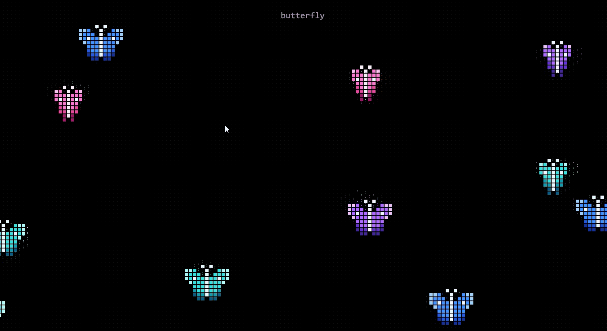

# Desktop Critters

A tiny pixel-art animal world that lives on your Windows desktop, behind your icons. Butterflies, jellyfish, dragonflies, koi, frogs and crabs wander around, leave little ASCII trails, and run away from your mouse. Click and they scatter.

I'm a humanities student teaching myself Python by building things, and this is my second project.



## What it does

- **Six animals, one species at a time:** butterflies, jellyfish, dragonflies, koi, frogs and crabs. Each one picks its own colour, so you get pink, blue and violet butterflies, white-and-red koi, and so on.
- **Each animal moves its own way:** butterflies flutter, jellyfish pulse, dragonflies dart and hover, koi glide, frogs hop, crabs scuttle sideways.
- **Mouse reactions:** they run away when your cursor gets close. A click makes a ripple and scatters them.
- **Fading ASCII trails** behind the animals.
- **Wallpaper mode:** runs behind your desktop icons.
- **Lock screen pictures:** saves a still image of any animal (see below).

## Run it

Needs Windows and Python 3. I tested it on Windows 11 (build 26200) with Python 3.15.

```
git clone https://github.com/sofnefk/pixel-critters.git
cd pixel-critters
pip install -r requirements.txt
```

Then pick a mode:

```
python critters.py                # preview in a normal window
python critters.py wallpaper      # behind your desktop icons
python critters.py snapshot koi   # saves lockscreen_koi.png
```

For `snapshot`, swap `koi` for butterfly, jellyfish, dragonfly, frog or crab.

> It uses **pygame-ce**, not the regular `pygame`. The regular one has no ready-made install for the newest Python versions, and pip then tries to build it from scratch and fails.

## Controls

| Keys | What it does |
|---|---|
| `Ctrl + Alt + →` | next animal |
| `Ctrl + Alt + ←` | previous animal |
| `Ctrl + Alt + Q` | quit (works in wallpaper mode too) |
| `Esc` | quit the preview window |

In wallpaper mode the terminal stays busy until you quit. It also prints some debug lines. "first drawing method not supported here" is normal on my PC.

## Settings

At the top of `critters.py`:

| Setting | What it does |
|---|---|
| `START_SPECIES` | which animal to start with (`"random"` or a name) |
| `AUTO_SWITCH_SECONDS` | change animal automatically every N seconds (0 = never, the default) |
| `COUNT_SCALE` | more animals (1.5) or fewer (0.6) |
| `CELL` | size of one pixel; bigger = chunkier and faster |
| `FPS` | lower it to save battery on a laptop |
| `FLEE_RADIUS`, `CLICK_RADIUS`, `CLICK_POWER` | how scared they are of the mouse |

## Lock screen

Windows doesn't allow animations on the lock screen, so `snapshot` saves a still picture instead. Then go to Settings → Personalization → Lock screen → Picture → Browse photos.

## Start with Windows (optional)

Press `Win + R`, type `shell:startup`, and put a file called `critters.bat` in that folder:

```
@echo off
timeout /t 10 /nobreak >nul
start "" "C:\path\to\pythonw.exe" "C:\path\to\critters.py" wallpaper
```

Use your own paths. `pythonw` runs without a terminal window, so quit with `Ctrl + Alt + Q`.

## Limits

- Windows only.
- Wallpaper mode depends on how Windows builds the desktop, and that changed in newer Windows 11 versions. I've only tested it on one PC. Windows 10 should use the older layout, which the code handles, but I haven't tested it.
- Primary monitor only.
- It redraws 30 times a second, so it uses some battery.
- If Explorer restarts, the wallpaper disappears. Just run it again.

## How it works

- Most animals are small pixel-art sprites written as text, where each letter is a colour from the animal's palette. Koi and dragonflies are built by code instead, because they bend and fly in any direction.
- The screen is a grid of cells. An animal lights up cells, and the cells fade out into ASCII characters, which makes the trails.
- Each animal has its own movement rules (hopping, pulsing, darting...) plus a bit of shared logic so they avoid each other and run from the mouse.
- Wallpaper mode uses the Windows API (through `ctypes`) to attach the window just under the desktop icons.

## What I learned

- My first version drew smooth blurry shapes and looked terrible. Hand-made pixel art with several colours per animal looked much better.
- On newer Windows 11, my first wallpaper attempt ran fine but showed nothing. I only found the problem by printing debug info and pasting it back, line by line. The order of the Windows steps mattered more than I expected.
- Small mistakes can break everything: pasting a file *after* the old one gave me a syntax error, and the newest Python needed `pygame-ce` instead of `pygame`.

## Why I made it

I saw a video of animated pixel animals on a screen and wanted my own on my desktop. When I showed it to my dad, he recognised the sprites straight away. He used to play with sprites in the late 80s, from a huge programming book his father brought back from the States. We ended up swapping stories, and he gave me a few ideas for what to add next.

## License

MIT, see [LICENSE](LICENSE).
